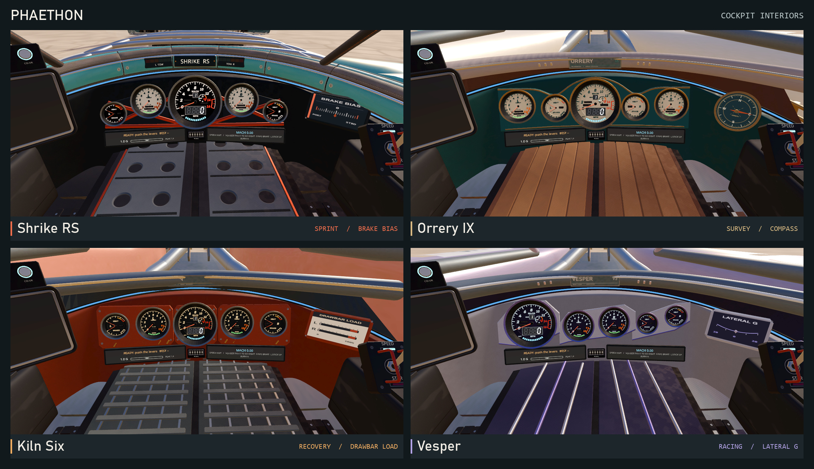

# Pilot fleet

The goal was to build three original pilot craft to the standard of Phaethon and Shrike RS. Each has its own engine body, cab, canopy, seat, coaming, grips, brakes, factory paint and engine mix. The twin-lever controls, working avionics and telescoping drawbars carry over. Cycle **Pilot craft** in either menu to select all five.


| Craft | Engine and cab | Tow length | Time to 1,000 mph |
| --- | --- | ---: | ---: |
| Phaethon | Original chassis | 16 m | 2.03 s |
| Shrike RS | Lightweight sprint chassis | 12.5 m | 1.68 s |
| Orrery IX | Three annular coils around each spindle, brass bus bars and a survey gondola with an observation cupola | 17 m | 1.93 s |
| Kiln Six | Six exposed cylinder heads per engine, bronze exhaust headers and a rescue cab with a split skylight | 15 m | 2.19 s |
| Vesper | Swept split inlets, bladed shoulders and a twin-keel cab with a dorsal fairing | 13.5 m | 1.63 s |

The range comparison uses equal 82% lever demand from a standing start at 480 simulation steps per second. The pilot-craft test selects and launches every chassis through both menus. It checks powered travel, independent braking, and the actual hardpoints of the working drawbars. For each new cockpit it casts rays from both eye positions at two head heights to five dials.

The preview uses the assembled game geometry in studio lighting. Physical headset tracking, comfort and standalone Quest frame time still require headset testing.

## Cockpits



| Craft | Flight deck | Starboard instrument |
| --- | --- | --- |
| Shrike RS | Exposed red truss, separate instrument pods and drilled heel plates | Brake bias shows which side is braking harder. |
| Orrery IX | Scalloped teal enamel, brass instrument bezels, ivory dials and slatted footboards | A compass shares the whole map's north reference. |
| Kiln Six | Bolted orange gauge cassettes, yellow handholds and bar grating | Two independent pointers show left and right drawbar load. |
| Vesper | Swept pearl panels, a port-side Mach dial and violet foot rails | A ball runs across a curved scale with lateral acceleration, up to 20 g each way. |

The cockpit renderer accepts `--interiors` for a seated view and instrument close-up of all four. `python tools/art_cockpit_meters.py` rebuilds the printed instrument cards.

## Geometry and finish pass (2026-11-23)

A pass over Shrike RS, Orrery IX, Kiln Six and Vesper to take out edges that read as computer-made, keeping each craft's design. The Phaethon and every part it shares with the four (the authored consoles, the mode switch panel, the vectoring nozzle) are untouched.

- **Turned parts and lines** (`Mesh.pipe`, `Mesh.sweep` in `tools/art_shrike_airframe.py`): every cut end is a quarter-round instead of a knife edge. Bends are sampled about every 12 degrees instead of three rings per bend. Thin parts get enough sides to read round (`sides_for`). A six-sided part no longer than it is wide is a nut, with radiused flats.
- **Pressings and brackets** (`Mesh.panel`): the edge radius rises to 42% of the gauge, in five steps, with radiused plan corners. A deep concave corner steps its radius down until the face is clean.
- **Loft ends** (`loft` in `tools/art_pilot_fleet.py`): a true quarter-round in four rows, where it was a two-row chamfer.
- **Cab sills**: the stations run on a shape-preserving cubic (`smooth_rows`). Where a sill stepped up to 32 cm outboard to clear the consoles, it creased, and its shading turned up to 89 degrees from its faces.
- **Seats**: the cushion is filled into a front pillow and a hip pillow, each tuft of the back is pillowed, the bolsters are crowned, and a piping cord runs along both upper edges of the cushion.
- **Harness** (`fit_harness` in `vr/fleet_flight_deck.gd`): straps are cast onto each craft's own seat. The shoulder straps come through slots in the back and run down its face, past an adjuster, to a cam-lock buckle on the cushion; the lap belts come from the hips to the same buckle. The Phaethon's flat straps were placed for its own seat, and on these seats they stood off the back.
- **Deck plates, slats, gratings and sill blocks**: `Finish.rounded_slab` replaces `beveled_plate`, giving radiused corners and rolled edges with smooth normals.
- **Baked occlusion** (`tools/art_bake_ao.py`): each vertex's view of the sky within a short reach is stored in the vertex colour's alpha. It uses NumPy and SciPy only: a voxel shell and 48 rays per vertex. `view/fleet_finish.gdshader` darkens ambient light by it, and direct light by 30% of it, so a hoop on a body or a pipe in a saddle sits in its own contact shadow. There is no runtime cost.
- **Specular anti-aliasing** in the same shader: roughness widens where the geometry's normal turns within a pixel, so a radiused edge's highlight holds still in the headset.

- **Floating parts**: each badge plaque is cast onto the skin it is fixed to and turns its edge down into that skin; before, it was a flat card a few millimetres off a curved skin. The lower actuator stubs now start inside the engine body (on the Orrery and the Vesper they ended in the air). The Orrery's outer brake-lamp sockets come in onto its tapered bulkhead (`LAMPS`). The Shrike's pod-brake struts start in their hinge barrel. The Vesper's cab-brake hinge moves 11 mm inboard onto the smoothed sill.

Triangles per craft, before and after: Shrike 42,524 to 71,320; Orrery 55,396 to 109,308; Kiln 51,104 to 111,484; Vesper 40,936 to 73,560. Godot's importer generates LODs for these meshes. GPU time was measured at headset size (offscreen 4128 x 2208, MSAA 4x, seat, chase and engine views, base and new builds run turn about, four rounds each). Shrike and Vesper are within 0.01 ms. Orrery is up to 0.05 ms higher, against a 0.15 ms spread between runs of the same build. Kiln's own runs spread by 0.36 ms. No cost could be separated from noise.

`python tools/inspect_craft_meshes.py [ART_DIR] [--strict]` reports, per part: triangles and vertices, pieces, floating pieces, collapsed triangles, reversed normals, the worst normal turn, and the occlusion range. `tests/render_fleet_detail.gd` renders fourteen close-ups per craft, with `--wire` for wireframes.

## Reproduce

From the worktree, run `python tools/art_pilot_fleet.py` (and `python tools/art_shrike_airframe.py` for the Shrike) to rebuild the original meshes and finish maps. NumPy, SciPy and Pillow are required. Import the project before testing, and confirm the import cache is newer than the rebuilt `.glb` files: once, an `--import` run scanned them without reimporting.

```powershell
$godot = (Get-Command Godot*_console.exe).Source
& $godot --headless --editor --path godot --import
& $godot --headless --xr-mode off --path godot -s res://tests/test_pilot_craft.gd -- --mute
```

For in-engine pictures on a PC available for windowed rendering, run the following from the worktree. The four views per craft cover the full rig, one engine, the cab and the pilot's eye.

```powershell
& $godot --xr-mode off --audio-driver Dummy --resolution 1600x900 --path godot -s res://tests/render_pilot_fleet.gd -- --mute --out="$PWD/build/fleet-views"
```
