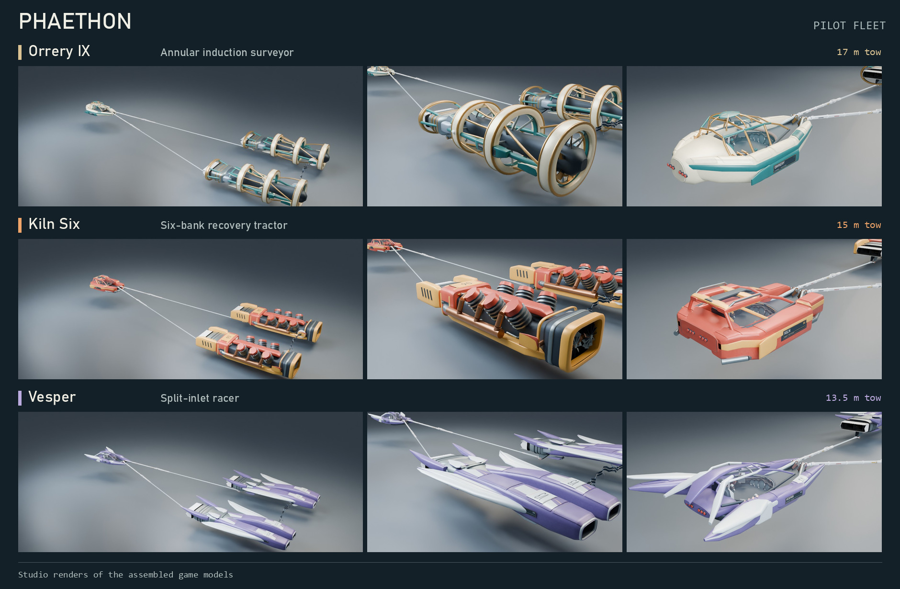

# Pilot fleet

The goal was to build three original pilot craft to the standard of Phaethon and Shrike RS. Each has its own engine body, cab, canopy, seat, coaming, grips, brakes, factory paint and engine mix. The twin-lever controls, working avionics and telescoping drawbars carry over. Cycle **Pilot craft** in either menu to select all five.



| Craft | Engine and cab | Tow length | Time to 1,000 mph |
| --- | --- | ---: | ---: |
| Phaethon | Original chassis | 16 m | 2.03 s |
| Shrike RS | Lightweight sprint chassis | 12.5 m | 1.68 s |
| Orrery IX | Three annular coils around each spindle, brass bus bars and a survey gondola with an observation cupola | 17 m | 1.93 s |
| Kiln Six | Six exposed cylinder heads per engine, bronze exhaust headers and a rescue cab with a split skylight | 15 m | 2.19 s |
| Vesper | Swept split inlets, bladed shoulders and a twin-keel cab with a dorsal fairing | 13.5 m | 1.63 s |

The range comparison uses equal 82% lever demand from a standing start at 480 simulation steps per second. The pilot-craft test selects and launches every chassis through both menus. It checks powered travel, independent braking, and the actual hardpoints of the working drawbars. For each new cockpit it casts rays from both eye positions at two head heights to five dials.

The preview uses the assembled game geometry in studio lighting. Physical headset tracking, comfort and standalone Quest frame time still require headset testing.

## Reproduce

From the worktree, run `python tools/art_pilot_fleet.py` to rebuild the original meshes and finish maps. NumPy and Pillow are required. Import the project before testing.

```powershell
$godot = (Get-Command Godot*_console.exe).Source
& $godot --headless --editor --path godot --import
& $godot --headless --xr-mode off --path godot -s res://tests/test_pilot_craft.gd -- --mute
```

For in-engine pictures on a PC available for windowed rendering, run the following from the worktree. The four views per craft cover the full rig, one engine, the cab and the pilot's eye.

```powershell
& $godot --xr-mode off --audio-driver Dummy --resolution 1600x900 --path godot -s res://tests/render_pilot_fleet.gd -- --mute --out="$PWD/build/fleet-views"
```
