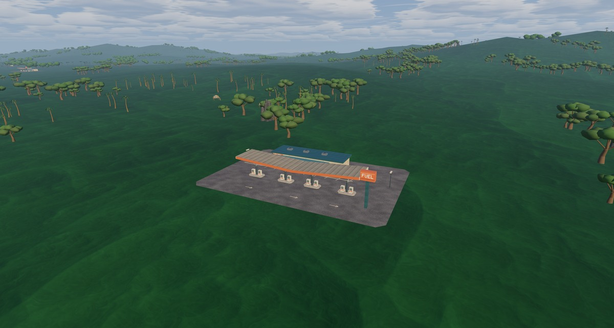
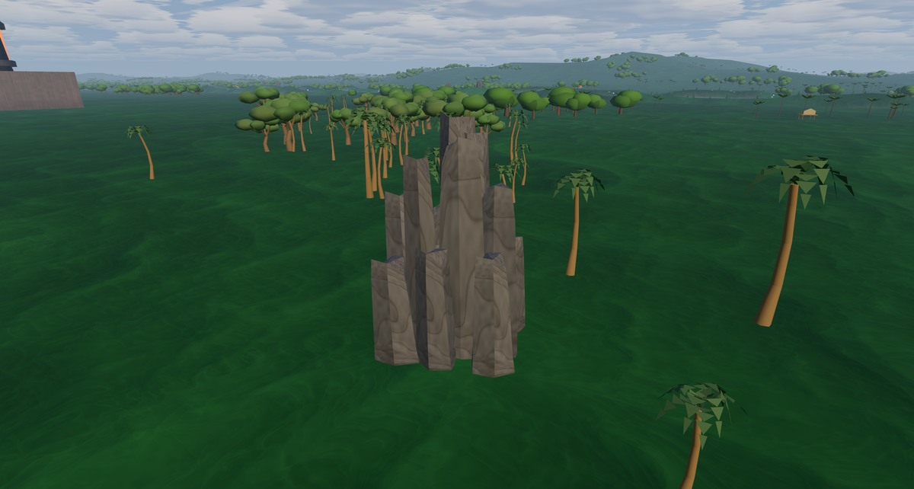

# Network roadside scenery

The 18 prop designs and both shared 2048 × 2048 atlases were authored for Phaethon. The fuel lettering is drawn by the atlas generator. The original model and texture generators are in `tools/roadside/source/`. They use Python, NumPy and Pillow. From the repository root, run `python tools/roadside/source/build.py` to rebuild the 36 GLBs, the two textures and `tools/roadside/catalog.json`. The catalog records the triangle counts, dimensions and horizontal radii in metres. A clean regeneration reproduced all 38 binary assets and the catalog byte for byte.

Godot exports `godot/roadside/`. The generator, catalog, benchmarks and screenshots live outside the exported assets. Both texture imports generate GPU-compressed mipmaps. The 36 GLBs use 3,816,408 source bytes and share two texture files totaling 1,613,216 bytes. Their 38 imported mesh and texture resources occupy 12,922,741 bytes before PCK compression. Each GLB has a single opaque surface. A packed PC VR smoke check loaded all 36 meshes and both 2,048-pixel atlases. A station’s pump apron faces the highway sample that placed it. A nine-point grade check sets its five-metre slab into the slope and leaves the apron 18 cm above the highest sampled point. City and landmark foundations reserve their footprints. The tile seed, terrain surface, region, water exclusions, maximum slope and road clearance still govern placement.

## Tile meshes

The landscape measures distance from the craft to the nearest point of the 8,192 m tile. Each kind has one MultiMesh per populated tile. A level change swaps the shared mesh and material on the same transform buffer. Shadows are off and every tier uses the same stream fade, snow and atmospheric haze.

| Distance to tile | Mesh |
| --- | --- |
| Under 4 km | Detailed, textured models for sparse batches. The untextured model serves denser batches, limiting detailed geometry to 8,192 triangles per kind per tile, or one singleton whose model exceeds that budget. |
| 4–12 km | Authored untextured models for rocks, infrastructure and smaller plants. Six common tree and shrub kinds use the Push 26 reduced shapes fitted to the new model bounds. |
| Over 12 km | Shared silhouettes of 24–72 triangles. The existing fade runs from 22 to 30 km. |

## Reproducing the comparison

Import both the baseline and the feature checkout with Godot 4.7.1 before running the comparison. From the feature checkout in PowerShell:

```powershell
$engine = (Get-Command Godot_v4.7.1-stable_win64_console.exe).Source
$baseline = 'C:/path/to/baseline/godot'
$env:APPDATA = (New-Item -ItemType Directory -Force .tools/roadside-appdata).FullName
& $engine --headless --path $baseline --editor --import
& $engine --headless --path godot --editor --import
python tools/roadside/compare.py --godot $engine --baseline $baseline --out .tools/roadside-measure
```

The helper executes the same benchmark script from the feature tree against both projects in before/after/after/before order. It writes a JSON record, a cockpit capture and a photograph of one real streamed placement per location per pass. Each viewport measures the production cockpit and a fully built Network with the same 4,128 × 2,208 pixels as both Quest 3 panels combined. Forward+ renders one view on the desktop GPU with 4× MSAA, VSync disabled, OpenXR off and the sound muted. A parked craft at a fixed road sample, a fixed 90 Hz simulation step and a reproducible traffic seed keep camera and terrain coordinates comparable. Each view warms for 60 frames and measures 120 more. The renderer reports visible draw calls and primitives. At each milepost the script also hides the streamed batches, then shows them again and counts stable changed pixels in a 4 × 4 sampling grid.

## Matched production results

Baseline `152c7b3` and integrated `0e3da2b`, Godot 4.7.1-stable on an RTX 5080. Results give baseline / integrated. The median columns average the two run medians. The P95 columns use the higher of the two run P95s. E1 westbound uses sample 2548 at (86,152, 100,000) m. Basalt uses sample 738 at (70,406.8, 89,884.5) m. These are the mile 38 and mile 11 areas in the recorded headset traces.

| Cockpit view | GPU ms, median | GPU ms, P95 | Visible primitives, median | Draws, median | View update CPU ms, median | Render CPU ms, median |
| --- | ---: | ---: | ---: | ---: | ---: | ---: |
| E1 west, mile 38 | 4.05 / 3.57 | 4.23 / 3.87 | 4,006,887 / 2,275,775 | 850 / 830 | 5.79 / 6.16 | 1.20 / 1.29 |
| Basalt, mile 11 | 4.46 / 3.96 | 4.69 / 4.12 | 5,269,613 / 2,639,125 | 1,283 / 1,267 | 4.68 / 5.13 | 1.47 / 1.58 |

Across the two measured feature views, median GPU time fell by 0.48 and 0.50 ms. Median view-update CPU time increased by 0.37 and 0.45 ms. The controls represent seated views with settled streaming. City and compound exclusions removed roughly 3,800 placements from the 81 loaded prop tiles around each view.

Godot reports viewport primitives across the scene. Roadside meshes are triangles. These frame times exclude OpenXR compositing and physical headset tracking. Both baseline runs bracketed an initial integration pair. Two more feature runs measured the final placement corrections with the same timed loop. The raw per-run summaries in `measurements.json` include GPU/CPU P95, draw and primitive counts, loaded instances, tile detail levels, coordinates and the visibility readbacks.

The real Network landscape test passed all 43 checks, including terrain mesh support, the station apron, complete mesh radii, deterministic reseeding, and road/city clearance. Its 162,540 road probes found at least 214.8 m of clearance in the independent footprint check. Its final worst streaming slice was 2.11 ms. Earlier wall-clock runs recorded 6.13 ms and, under concurrent load, 146.10 ms against the existing 6 ms threshold. The baseline passed the same timing gate at 4.79 ms.

The close-ups below use the live streamed MultiMeshes after the cockpit timings. Each selected object was hidden separately and its contribution to the center of the image checked before capture.




